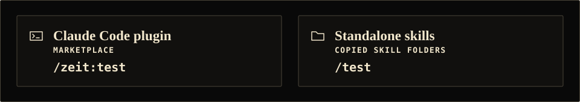
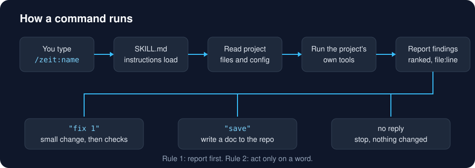
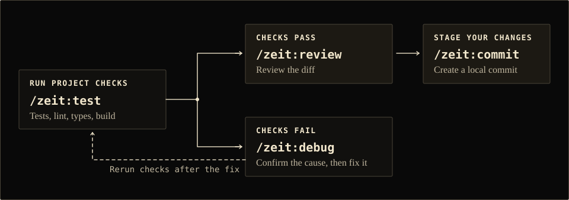

# zeit

Run your project’s checks, review a diff, audit dependencies, diagnose a failure, or prepare a release from Claude Code. Each of the 15 skills has its own `/zeit:` command and follows the instructions in its `SKILL.md` file.

[Install](#install) · [First run](#first-run) · [How it works](#how-it-works) · [Command reference](#command-reference) · [Workflows](#workflows) · [Troubleshooting](#troubleshooting)

## Install

Run these commands from your terminal with Claude Code installed.

```bash
claude plugin marketplace add zeitgeistz/zeit-skills
claude plugin install zeit@zeit-skills
```

Open Claude Code in a project and type `/zeit:` to see the commands. The test, build, and audit skills use the tools available in that project.



<details>
<summary>Install standalone skill folders</summary>

Use this route if you want unprefixed commands such as `/test` and `/review` in Claude Code.

**macOS or Linux**

```bash
git clone https://github.com/zeitgeistz/zeit-skills.git
mkdir -p ~/.claude/skills
cp -R zeit-skills/skills/* ~/.claude/skills/
```

**Windows PowerShell**

```powershell
git clone https://github.com/zeitgeistz/zeit-skills.git
New-Item -ItemType Directory -Path "$HOME\.claude\skills" -Force | Out-Null
Copy-Item -Path '.\zeit-skills\skills\*' -Destination "$HOME\.claude\skills" -Recurse
```

For other coding agents, use the individual Markdown instructions from [skills/](skills/). The setup and `/zeit:` command names in this README are for Claude Code.

</details>

## First run

1. **`/zeit:test`** runs the project’s existing tests, linter, type checker, and build where available. It groups failures by cause and identifies what to fix first.
2. **`/zeit:review`** reviews your current diff, including staged changes. It ranks findings and cites the affected code.
3. **`/zeit:security`** audits project-wide risks. Use **`/zeit:threats login`** when you want to focus on one feature.

## How it works

Claude loads the instructions for the command you invoke. Skills inspect the relevant files and use project tools where applicable. Most start with a report. Check the [command reference](#command-reference) for the skills that edit files or create local Git changes.



## Command reference


`<angle brackets>` mark an input. `[Square brackets]` mark optional inputs or actions.

| Command | Use it for | Changes |
| --- | --- | --- |
| [`/zeit:test`](skills/test/SKILL.md) `[path] [filter]` | Run project checks and group failures by cause | May install missing project dependencies |
| [`/zeit:review`](skills/review/SKILL.md) `[path or branch]` | Find bugs and security risks in a diff, file, or branch | Reports only |
| [`/zeit:code-check`](skills/code-check/SKILL.md) `[path]` | Find dead code, duplication, oversized files, and unused dependencies | Reports only |
| [`/zeit:perf`](skills/perf/SKILL.md) `[path] [url]` | Find large bundles, slow queries, and expensive renders | Reports only. Endpoint measurements use GET |
| [`/zeit:security`](skills/security/SKILL.md) `[path]` | Audit secrets, dependencies, access control, inputs, and config | `save` writes a baseline. `fix N` addresses one finding |
| [`/zeit:threats`](skills/threats/SKILL.md) `<feature>` | Map a feature’s data flow and check its controls | `save` writes the threat model. `fix N` addresses one gap |
| [`/zeit:improve`](skills/improve/SKILL.md) `<path> [goal]` | Make one small fix, rerun checks, and show the diff | Can edit files when invoked. Larger edits require approval |
| [`/zeit:design-check`](skills/design-check/SKILL.md) `<path> [fix]` | Review a UI for accessibility, usability, and visual hierarchy | `fix` applies small UI edits |
| [`/zeit:deps`](skills/deps/SKILL.md) `[path] [upgrade safe]` | Group outdated and vulnerable dependencies by upgrade risk | `upgrade safe` applies eligible updates and runs checks |
| [`/zeit:architecture`](skills/architecture/SKILL.md) `[path] [write]` | Map project structure, dependencies, and a key data flow | `write` generates `docs/architecture.md` |
| [`/zeit:docs`](skills/docs/SKILL.md) `[path] [fix]` | Check setup steps, scripts, and examples against the code | `fix` edits documentation |
| [`/zeit:debug`](skills/debug/SKILL.md) `<error or description>` | Reproduce a bug and confirm its cause | `fix` applies the proposed fix |
| [`/zeit:commit`](skills/commit/SKILL.md) `[message hint]` | Review staged changes and write a Conventional Commit | Creates a local commit |
| [`/zeit:release`](skills/release/SKILL.md) `[version or bump]` | Run release checks, choose a version, and draft the changelog | After approval, updates release files and creates a local commit and tag |
| [`/zeit:focus`](skills/focus/SKILL.md) | Use brief, action-first replies | Changes reply style. Say `stop focus` to exit |

## Workflows

### Day-to-day development



| When | Commands |
| --- | --- |
| Plan a feature | Run `/zeit:threats <feature>` to identify controls, then run `/zeit:review` on the implementation. |
| Polish a UI | Run `/zeit:design-check <path>`, apply the selected fixes, then run `/zeit:test`. |
| Prepare a release | Review `/zeit:security`, `/zeit:deps`, `/zeit:docs`, and `/zeit:perf` findings as relevant. Run `/zeit:release` once the branch is ready. Push or publish separately. |

## Sample output

An illustrative `/zeit:test` report for a project with four configured checks.

```text
Result: 3 of 4 checks pass.

Failing check: npm test
Cause: Missing env var API_URL
Affected tests: 6 across auth.spec.ts and api.spec.ts

Fix first: Set API_URL in .env.test and rerun the test suite.
```

## Safety rules

- Reports cite code locations or tool output. Secret findings cite the location and omit the value.
- The test and debug skills preserve failing tests as evidence. The docs skill limits its edits to documentation.
- Commits and tags created by the skills stay local. Pushing, publishing, and deploying are separate actions.

## Update, disable, remove

```bash
claude plugin update zeit@zeit-skills
```

To pause the plugin, open `/plugin`, find **zeit** under **Installed**, and select **Disable plugin**.

```bash
claude plugin uninstall zeit@zeit-skills
claude plugin marketplace remove zeit-skills
```

For a standalone install, remove the copied zeit skill folders from `~/.claude/skills/`. See the [Claude Code plugin guide](https://code.claude.com/docs/en/discover-plugins) for more on updates and plugin management.

## Troubleshooting

| Problem | What to check |
| --- | --- |
| `/zeit:` is missing | Run `/reload-plugins` or restart Claude Code. Check the **Installed** tab in `/plugin`. |
| Commands appear twice | Keep one installation route. The plugin adds `/zeit:` commands and standalone folders add unprefixed commands. |
| An audit or build tool is missing | Check the tool named in the report. The skills use the project’s existing tooling. |
| `/zeit:test` finds no tests | Check that the project has a test script or test files in the expected location. |
| A finding needs verification | Ask for the code location or command output behind the finding. |

## Contributing

Skills are defined in [skills/](skills/). Plugin and marketplace metadata live in [.claude-plugin/](.claude-plugin/), and the README illustrations live in [docs/](docs/).

1. Add `skills/<name>/SKILL.md` with `name` matching the folder, a `description`, an `argument-hint` if needed, and `disable-model-invocation: true`.
2. Define the inputs, evidence to report, and any actions the skill can take.
3. Add the skill to the command reference and run the repository checks with Node.js 18 or later.

```bash
node scripts/check.mjs
```

## License

[MIT](LICENSE)
