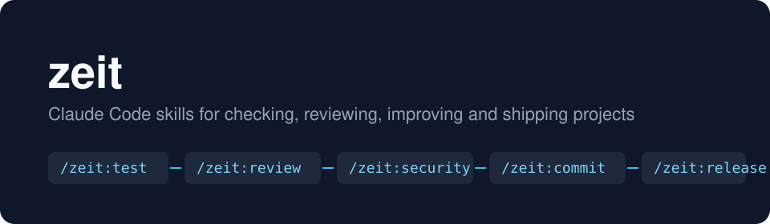
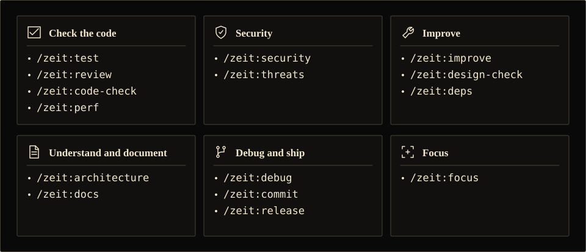
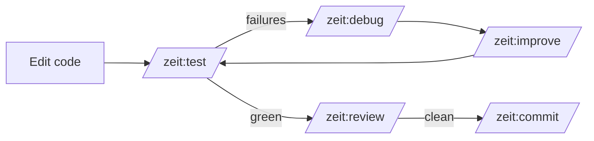
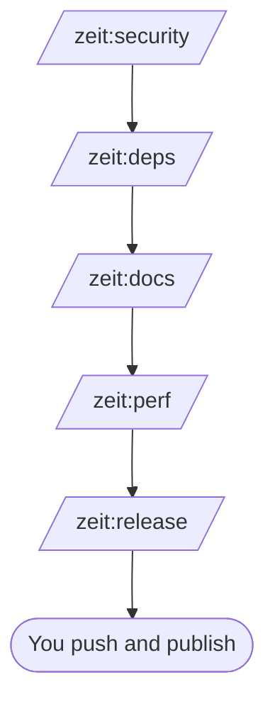
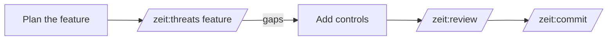
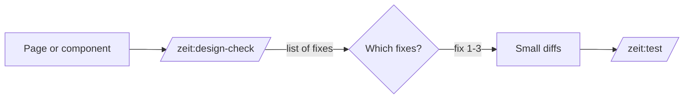

<p align="center">
  
</p>

<p align="center">
  <a href="https://github.com/zeitgeistz/zeit-agent-skills/actions/workflows/check.yml"></a>
  
  
  
</p>

# zeit

**Fifteen agent skills for the whole life of a project:** check it, review it, improve it, secure it, document it, debug it, commit it and release it.

The skills are plain Markdown instructions, so any coding agent can follow them. They are designed mainly for [Claude Code](https://claude.com/claude-code), which is the only agent where the install commands below are tested.

Every command starts with `/zeit:`, so they are easy to find. Each one reports first and changes files only when you ask.

```text
/zeit:test                  # what fails, and what to fix first
/zeit:threats login         # what could go wrong with login, and which controls are missing
/zeit:release               # is it ready to tag, and what the changelog says
```

---

## Contents

- [How it works](#how-it-works)
- [Install](#install)
- [First run in five minutes](#first-run-in-five-minutes)
- [Command reference](#command-reference)
- [Typical workflows](#typical-workflows)
- [Safety rules](#safety-rules)
- [Update, disable, remove](#update-disable-remove)
- [Troubleshooting](#troubleshooting)
- [Develop and contribute](#develop-and-contribute)

---

## How it works

Each skill is a `SKILL.md` file: a set of instructions that Claude Code loads when you type its command. Nothing runs in the background.

<p align="center">
  
</p>

Two rules shape every skill:

1. **Report first.** The default output is a ranked list with `file:line` evidence. Nothing is edited.
2. **Act only on a word.** Changes happen only after `fix`, `upgrade safe`, `save`, `write`, or a named item such as `fix 1`.

---

## Install

You need [Claude Code](https://claude.com/claude-code) and, for some skills, the tools of the project you check (npm, pip, git, and so on).

<p align="center">
  
</p>

### Option A: plugin install (recommended)

In a terminal:

```bash
claude plugin marketplace add zeitgeistz/zeit-agent-skills
claude plugin install zeit@zeit-agent-skills
```

Then start Claude Code and type `/zeit:` to see the list.

### Option B: manual copy

If you do not want the plugin system, copy the skill folders into your skills directory. The commands become `/test`, `/review` and so on, without the `zeit:` prefix.

```bash
git clone https://github.com/zeitgeistz/zeit-agent-skills.git
cp -r zeit-agent-skills/skills/* ~/.claude/skills/
```

On Windows (PowerShell):

```powershell
git clone https://github.com/zeitgeistz/zeit-agent-skills.git
Copy-Item -Recurse zeit-agent-skills\skills\* $HOME\.claude\skills\
```

> Do not use Option A and Option B at the same time. The same skills would show up twice.

### Check that it works

Type `/zeit:` in Claude Code and wait for the list. If it is empty, see [Troubleshooting](#troubleshooting).

---

## First run in five minutes

1. Open a project that has tests (for example, any project with `npm test` or `pytest`).
2. Run the checks:
   ```text
   /zeit:test
   ```
   You get the failures grouped by cause, with the first one to fix.
3. Look at the code you changed most recently:
   ```text
   /zeit:review
   ```
4. Check the security of the whole project:
   ```text
   /zeit:security
   ```
5. If the project has a login, threat-model it:
   ```text
   /zeit:threats login
   ```

You have now checked the project. Nothing in it has changed.

---

## Command reference

Every command takes an optional argument. Arguments in `[brackets]` are optional.

<p align="center">
  
</p>

### Check the code

| Command | Use it to | Arguments | Changes files? |
|---|---|---|---|
| `/zeit:test` | Run the project's tests, lint, type check and build. Group failures by cause | `[path]` `[test-filter]` | Never |
| `/zeit:review` | Find real bugs, security holes and error-handling gaps in a file, diff or branch | `[path \| branch \| diff]` | Never |
| `/zeit:code-check` | Measure code health: dead code, duplication, big files, unused dependencies | `[path]` | Never |
| `/zeit:perf` | Find slow code (bundle size, N+1 queries, unbounded lists) and rank it by impact | `[path] [url]` | Never |

### Security

| Command | Use it to | Arguments | Changes files? |
|---|---|---|---|
| `/zeit:security` | Audit the whole project: secrets, dependencies, auth, input handling, config | `[path]` `[save]` `[fix N]` | Only with `save` or `fix` |
| `/zeit:threats` | Threat-model one feature (STRIDE plus feature-specific abuse cases) and show which controls are missing | `<feature>` `[save]` `[fix N]` | Only with `save` or `fix` |

### Improve

| Command | Use it to | Arguments | Changes files? |
|---|---|---|---|
| `/zeit:improve` | Make one small, verified fix in one file, with a diff and an undo command | `<path> [goal]` | Yes, one small change |
| `/zeit:design-check` | Review a UI for usability, accessibility and generic "AI slop" design | `<path>` `[fix]` | Only with `fix` |
| `/zeit:deps` | List outdated and vulnerable dependencies, grouped by risk | `[upgrade safe]` | Only with `upgrade safe` |

### Understand and document

| Command | Use it to | Arguments | Changes files? |
|---|---|---|---|
| `/zeit:architecture` | Map the structure and one key flow, with the top risks. Asks if you want a Mermaid diagram | `[path]` `[write]` | Only with `write` |
| `/zeit:docs` | Check that README and docs match the code (scripts, env vars, routes, paths) | `[path]` `[fix]` | Only docs, and only with `fix` |

### Debug and ship

| Command | Use it to | Arguments | Changes files? |
|---|---|---|---|
| `/zeit:debug` | Reproduce a bug, rank its causes, and confirm the real one with evidence | `<error or description>` `[fix]` | Only with `fix` |
| `/zeit:commit` | Check staged changes for secrets and leftovers, then write a Conventional Commit | `[message hint]` | Local commit only |
| `/zeit:release` | Pre-release checklist: checks, version, changelog, local tag | `[major\|minor\|patch\|x.y.z]` | Local only. Never pushes |

### Other

| Command | Use it to | Arguments | Changes files? |
|---|---|---|---|
| `/zeit:focus` | Short, action-first replies with numbered steps and one next step | none | No |

Use `/zeit:focus` to turn the style on. Say `stop focus` to turn it off.

---

## Typical workflows

### Daily development



### Before a release



Release never pushes. You run the push and publish steps yourself after reading the checklist.

### A new feature



Run the threat model before you write the feature. It shows the controls you need.

### UI polish



---

## Sample output

What `/zeit:test` reports when two things are broken:

```text
Result: 3 of 4 checks pass. Test suite fails.

Failures grouped by cause:
1. Missing env var `API_URL`: 6 tests (auth.spec.ts, api.spec.ts)
   Fix: set `API_URL` in `.env.test`
2. Type error `User.id` is `string`, code expects `number`: 2 errors
   Fix: src/user.ts:14, change the type to `string`

Fix first: #1. It likely clears most failures.
Next: say "fix 1" and I will make the change.
```

What `/zeit:threats login` produces:

```text
Feature: login (3 entry points: POST /login, POST /login/mfa, GET /reset)

| Threat                     | Status    | Where / gap                                   |
|----------------------------|-----------|-----------------------------------------------|
| Brute force on POST /login | Missing   | No rate limit found in routes or middleware   |
| Account enumeration        | Partial   | 404 for unknown users (login.ts:31)           |
| Session fixation           | Mitigated | Session regenerated at login.ts:48            |
| Open redirect via ?next=   | Missing   | next used directly in redirect (login.ts:60)  |
```

---

## Safety rules

- **No pushes, deploys or publishes.** `/zeit:commit` commits locally. `/zeit:release` tags locally. You push.
- **No secret values in output.** Secret findings show the file and line only. Rotate any real secret yourself.
- **No test edits to make things pass.** `/zeit:test` and `/zeit:debug` never change tests to hide failures.
- **Only the docs change in `/zeit:docs`.** It never edits code to match the docs.
- **Read-only measurement.** `/zeit:perf` sends only GET requests and never runs load tests.
- **Stated checks only.** Each report says what was checked and what was not, so a "no problems" result is not mistaken for "secure".

---

## Update, disable, remove

**Update** (plugin install): uninstall and install again.

```bash
claude plugin uninstall zeit
claude plugin install zeit@zeit-agent-skills
```

**Disable** temporarily: `claude plugin --help` lists the disable command for your version.

**Remove** completely:

```bash
claude plugin uninstall zeit
claude plugin marketplace remove zeit-agent-skills
```

For manual installs, delete the copied folders from `~/.claude/skills/`.

---

## Troubleshooting

| Problem | Fix |
|---|---|
| `/zeit:` shows no commands | Restart Claude Code. Skills load at startup. |
| A command says a tool is missing (for example `npm audit`, `pip-audit`) | Install that tool for your project, or ignore that check. The report names what was skipped. |
| `/zeit:test` says there are no tests | Add tests first. The skill never invents them. |
| `/zeit:deps` shows nothing outdated | Check that the lockfile is committed. Without it, the skill cannot compare versions. |
| Two copies of each command appear | You installed both the plugin and the manual copy. Remove one. |
| Command output seems wrong | Ask Claude to show the evidence (file and line). Every finding should cite one. |

---

## Develop and contribute

### Layout

```text
zeit-agent-skills/
├── .claude-plugin/
│   ├── plugin.json          # plugin name, version, description
│   └── marketplace.json     # lets Claude Code install from this repo
├── skills/
│   ├── test/SKILL.md        # one folder per skill
│   ├── review/SKILL.md
│   └── ...                  # 15 skills in total
├── scripts/
│   └── check.mjs            # repo checks, run in CI
├── .github/workflows/
│   └── check.yml            # runs scripts/check.mjs on push and pull request
└── docs/
    └── banner.svg
```

### Add a skill

1. Create `skills/<name>/SKILL.md`.
2. Start the file with frontmatter. The `name` must equal the folder name:
   ```markdown
   ---
   name: <name>
   description: One sentence on what it does and when to use it.
   argument-hint: [optional arguments]
   disable-model-invocation: true
   ---
   ```
3. Write the instructions. Report first, and act only on a clear word from the user.
4. Run the checks:
   ```bash
   node scripts/check.mjs
   ```
5. Add a row to the command reference above.
6. Bump `version` in `.claude-plugin/plugin.json` for each release.

### What CI checks

- Both manifests are valid JSON with the required fields.
- Every skill has a `SKILL.md` with frontmatter, and its `name` matches its folder.
- Every `/zeit:<name>` reference in a skill points to a skill that exists.

### Rules for contributions

- Keep each skill focused on one job.
- Every finding must cite evidence (a file, a line, or a command output).
- Do not add a skill that pushes, publishes or deletes data without an explicit word from the user.

---

## License

Not yet chosen. Until a license file is added, all rights are reserved by the author and the code is not licensed for reuse.
