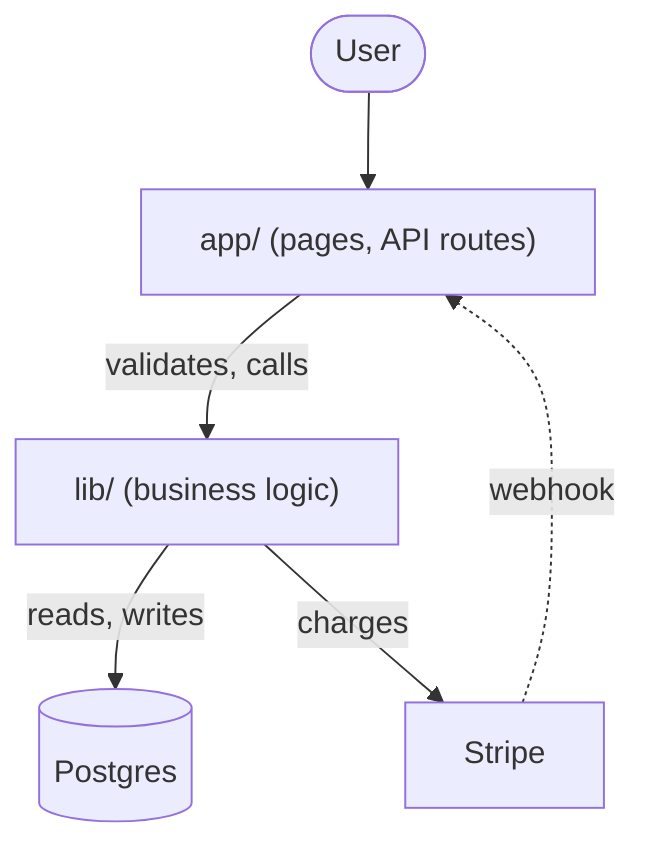

# zeit-architecture

Explain how the project is built, so a reader can find their way in ten minutes. Read-only unless `$ARGUMENTS` contains `write`.

## 1. Survey

- Read the root: README, manifests (`package.json`, `pyproject.toml`, `Cargo.toml`, `go.mod`), config files, Dockerfile, CI files.
- List the folder tree to depth 3, skipping `node_modules`, `.git`, build output, and vendored code.
- Identify the stack: language, framework, database, queue, external services (from imports and env var names, not from guesses).

## 2. Find the parts

For each main folder, state in one line what it does. Then identify:
- **Entry points**: where the program starts (server, CLI, main UI, workers).
- **Layers**: UI, routes or controllers, services or business logic, data access, external clients. Say which layers exist, not which ones you would like to exist.
- **Data**: main data models or schemas, where they live, and which code reads and writes them.
- **External calls**: APIs, databases, file storage, and queues the code talks to.

## 3. Trace two or three key flows

Pick the most important user flow (for example, "user signs up", "upload file", "checkout") and trace it from entry point to storage. List each file it passes through in order. This is the most useful part of the map. Do not skip it.

## 4. Judge the design

Report only what you can point to in the code:
- **Coupling**: a UI file that queries the database directly, or a module that imports from many unrelated modules.
- **Circular imports** between modules.
- **Duplication**: the same logic in two places that have already diverged.
- **Unclear ownership**: the same data written from several places.
- **Config spread**: settings read from many places with no single source.
- **Missing boundaries**: no tests or interfaces around external services, so changing one breaks many things.

Do not propose a rewrite. Name the two or three changes that would reduce the most risk, and the smallest step for each.

## 5. Report

```
Stack: Next.js 14, Postgres (Prisma), Stripe, Resend email.
Entry points: `app/` (web), `scripts/sync.ts` (nightly job).

Structure:
- `app/` - pages and API routes (UI and HTTP together)
- `lib/` - business logic and Prisma client
- `components/` - UI only, no data calls (good)

Main flow: checkout
1. `app/checkout/page.tsx` - form
2. `app/api/checkout/route.ts` - validates, calls Stripe
3. `lib/orders.ts` - writes order to Postgres
4. `app/api/webhooks/stripe/route.ts` - marks order paid

Risks, most important first:
1. Order status is written from 2 places (`lib/orders.ts:40`, webhook route:22). They can disagree.
   Smallest step: make the webhook the only writer.
2. `lib/` imports from `app/`, the reverse of the intended direction (`lib/mail.ts:3`).
   Smallest step: move the shared type into `lib/types.ts`.

Not covered: background jobs beyond `scripts/sync.ts`, infra config.
```

## 6. Ask about a diagram

After the report, ask one question and wait for the answer:

"Want a diagram too? (1) Mermaid, renders on GitHub, no install, recommended (2) Excalidraw, editable in a browser, needs an extra skill (3) No."

If `write` was passed, skip the question and make the Mermaid diagram.

### Option 1: Mermaid (default)

Make one diagram with two levels:
1. **Context**: the system, its users, and external services. Use `flowchart LR`.
2. **Containers**: the main folders or services and the arrows between them, with the data each arrow carries. Use `flowchart TB`.

Rules:
- Max 12 nodes per diagram. Group the rest.
- Label nodes with real folder or service names from the code. No invented names.
- Arrows show direction of calls or data, and each label is a verb ("reads", "writes", "calls").
- Put the main flow from section 3 in a `sequenceDiagram` only if it has 4 or more steps.

Example:



Save it in `docs/architecture.md` with a short header and the Mermaid block. GitHub renders it in the browser. Do not overwrite an existing file without showing the diff first.

### Option 2: Excalidraw (optional)

Excalidraw gives a hand-drawn, editable file. It needs a skill that is not installed here. Two options exist: `excalidraw-architecture` (mergisi/awesome-openclaw-agents), which writes `docs/architecture.excalidraw` from the codebase, and `dirnbauer/webconsulting-skills`, which also exports PNG or SVG. Ask the user before installing either. Do not install third-party skills without approval.

If the user picks Excalidraw and approves installing, follow that skill's instructions and use the same Context and Containers levels from Option 1.

## 7. Save

With `write`, save the report as `ARCHITECTURE.md` at the project root with a "Last reviewed" date. Put the Mermaid diagram in the same file. Do not overwrite an existing file without showing the diff first.
